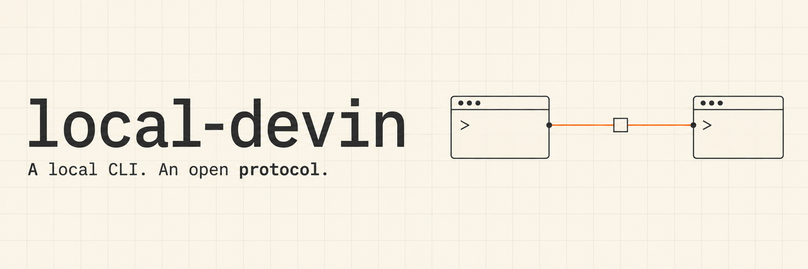

# local-devin

[English](README.md) · [简体中文](README.zh-CN.md) · **日本語**

手元の **Devin CLI** を標準の MCP サーバーとして公開するブリッジです。Claude Code、Cursor、Windsurf、Codex などの MCP クライアントからローカルの Devin に開発タスクを直接委任し、既存のログイン状態や開発環境をそのまま活かしてセッション ID 指定で対話を継続できます。

```text
MCP クライアント  ── stdio ──▶  local-devin  ──▶  ローカル Devin CLI  ──▶  ローカルリポジトリ
```

- **依存関係ゼロですぐ使える**：ビルド済みの `dist/` を同梱しており、クローン後は `node` でそのまま起動できます。`npm install` や別途の API キー取得は不要です。
- **明確な役割分担**：[公式 Devin MCP](https://docs.devin.ai/work-with-devin/devin-mcp) はクラウド環境の管理用、[Devin ACP](https://docs.devin.ai/cli/reference/commands#devin-acp) は ACP 対応エディタの直接接続用です。本プロジェクト（非公式）は、任意の MCP クライアントからローカル CLI と保存済みセッションを扱うことに特化しています。

## クイックスタート

**Node.js 22 以上**と、ログイン済みの **Devin CLI**（`devin auth status`）が必要です。対象プロジェクトで初めて使う前に、そのディレクトリで一度 `devin` を対話起動してワークスペースの信頼確認を済ませてください。

1. リポジトリをクローンします：

```sh
git clone https://github.com/aynls/Devin-mcp.git
```

2. MCP クライアントの設定にサーバーを追加します（絶対パスに置き換えてください）：

```json
{
  "mcpServers": {
    "local-devin": {
      "command": "node",
      "args": ["/ABSOLUTE/PATH/Devin-mcp/dist/index.js"],
      "env": {
        "DEVIN_CWD": "/ABSOLUTE/PATH/your-project"
      }
    }
  }
}
```

- **複数プロジェクトでの利用**：`DEVIN_CWD` を省略し、ツール呼び出しごとにプロジェクトの絶対パス `cwd` を渡す運用も可能です。
- **GUI クライアントでコマンドが見つからない場合**：シェルの `PATH` を引き継がないアプリでは、`command` に `node` の絶対パスを指定し、`env` の `DEVIN_BIN` に `devin` 実行ファイル（Windows では `devin.exe`）を指定してください。

## ツール

| ツール | 引数 | 用途 |
| --- | --- | --- |
| `run_prompt` | `prompt`, `cwd?` | 新しい非対話タスクを実行し、出力と `sessionId` を返す。 |
| `resume_session` | `prompt`, `sessionId`, `cwd?` | 指定した `sessionId` のセッションを文脈ごと再開する。 |
| `list_sessions` | `cwd?` | 対象ワークスペースのローカルセッション（`id`、`title`、`lastActivityAt`）を一覧取得する。 |
| `auth_status` | なし | `devin auth status` を実行してログイン状態を確認する。 |

`run_prompt` と `resume_session` の任意引数：`permissionMode`（`auto` | `accept-edits` | `smart` | `dangerous`、既定値 `auto`）、`model`（モデル名またはエイリアス）、`respectWorkspaceTrust`（既定値 `true`）、`timeoutMs`（1 回あたりのタイムアウトミリ秒）。

実際の利用時は、ホスト側のエージェントへ自然言語で指示するだけで連携できます：

> local-devin でこのプロジェクトのテスト構成を調べて。ファイルは変更せず、続けて質問できるように返ってきた sessionId を控えておいて。

## 設定

| 環境変数 | 既定値 | 説明 |
| --- | --- | --- |
| `DEVIN_CWD` | 未設定 | 既定ワークスペースの絶対パス。未設定時は毎回の呼び出しで `cwd` が必須。 |
| `DEVIN_BIN` | 自動検出 | `devin` 実行ファイルの絶対パス。 |
| `DEVIN_MCP_TIMEOUT_MS` | `600000` | 1 コマンドあたりのタイムアウト上限（既定 10 分）。 |
| `DEVIN_MCP_MAX_OUTPUT_BYTES` | `1048576` | 1 コマンドあたりの出力サイズ上限（既定 1 MiB）。 |
| `DEVIN_MCP_ALLOW_DANGEROUS` | `false` | `true` にすると `permissionMode: "dangerous"` の指定を許可。 |
| `DEVIN_MCP_ALLOW_UNTRUSTED` | `false` | `true` にすると `respectWorkspaceTrust: false` の指定を許可。 |

ツール呼び出しは同期実行され、CLI の完了後にまとめて結果が返ります。既定設定では、MCP クライアント側のツールタイムアウトを **11 分以上**に設定することを推奨します。同一ワークスペースで同時に実行できるタスクは 1 つです。

## 開発

`server/` 配下のソースを変更した場合は、再ビルドして更新後の `dist/` もコミットしてください：

```sh
npm ci
npm run check
npm run verify:package
```

## ライセンス

[MIT](LICENSE)
