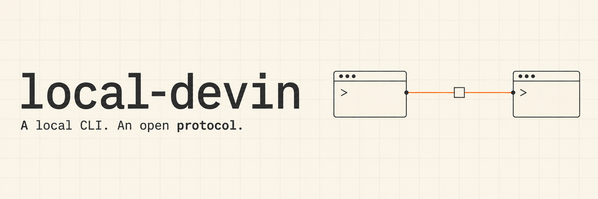

# local-devin

**English** · [简体中文](README.zh-CN.md) · [日本語](README.ja.md)

Expose your local **Devin CLI** as a standard MCP server. Delegate coding subtasks to Devin directly from Claude Code, Cursor, Windsurf, Codex, or any MCP client—reusing your local login and toolchain, with multi-turn follow-ups by session ID.

```text
MCP client  ── stdio ──▶  local-devin  ──▶  Local Devin CLI  ──▶  Local codebase
```

- **Zero dependencies, ready to run**: Prebuilt `dist/` is committed—clone and launch directly with `node`, no `npm install` or separate API key required.
- **Focused scope**: The [official Devin MCP](https://docs.devin.ai/work-with-devin/devin-mcp) manages cloud instances, and [Devin ACP](https://docs.devin.ai/cli/reference/commands#devin-acp) connects ACP-capable editors directly; this unofficial bridge exposes your local CLI and saved local sessions to any MCP client.

## Quick start

Requires **Node.js 22+** and an authenticated **Devin CLI** (`devin auth status`). Before using a target project for the first time, launch `devin` interactively in that directory once to accept the workspace trust prompt.

1. Clone the repository:

```sh
git clone https://github.com/aynls/Devin-mcp.git
```

2. Add the server to your MCP client configuration (replace with absolute paths):

```json
{
  "mcpServers": {
    "local-devin": {
      "command": "node",
      "args": ["/ABSOLUTE/PATH/Devin-mcp/dist/index.js"],
      "env": {
        "DEVIN_CWD": "/ABSOLUTE/PATH/your-project"
      }
    }
  }
}
```

- **Multiple projects**: Omit `DEVIN_CWD` and let the caller pass an absolute `cwd` per tool call.
- **Binary not found in GUI clients**: If a desktop app does not inherit your shell `PATH`, set `command` to the absolute `node` path and set `DEVIN_BIN` in `env` to the `devin` executable (`devin.exe` on Windows).

## Tools

| Tool | Parameters | Purpose |
| --- | --- | --- |
| `run_prompt` | `prompt`, `cwd?` | Start a new non-interactive task; returns output and `sessionId`. |
| `resume_session` | `prompt`, `sessionId`, `cwd?` | Continue a specific session by exact `sessionId` with full context. |
| `list_sessions` | `cwd?` | List saved local sessions (`id`, `title`, `lastActivityAt`) in the workspace. |
| `auth_status` | None | Run `devin auth status` to check local authentication. |

Optional parameters for `run_prompt` and `resume_session`: `permissionMode` (`auto` | `accept-edits` | `smart` | `dangerous`, default `auto`), `model` (model name or alias), `respectWorkspaceTrust` (default `true`), and `timeoutMs` (per-command timeout in ms).

In practice, delegate tasks in plain language through your host agent:

> Use local-devin to inspect this project's test setup without editing files, and keep the returned sessionId for follow-up questions.

## Configuration

| Variable | Default | Description |
| --- | --- | --- |
| `DEVIN_CWD` | Unset | Default absolute workspace path; required on each call if unset. |
| `DEVIN_BIN` | Auto-detected | Absolute path to the `devin` executable. |
| `DEVIN_MCP_TIMEOUT_MS` | `600000` | Per-command timeout ceiling (default 10 minutes). |
| `DEVIN_MCP_MAX_OUTPUT_BYTES` | `1048576` | Combined output limit per command (default 1 MiB). |
| `DEVIN_MCP_ALLOW_DANGEROUS` | `false` | Set to `true` to allow callers to request `permissionMode: "dangerous"`. |
| `DEVIN_MCP_ALLOW_UNTRUSTED` | `false` | Set to `true` to allow callers to request `respectWorkspaceTrust: false`. |

Calls are synchronous and return once the CLI finishes; with default settings, set your MCP client's tool timeout to **at least 11 minutes**. Only one task runs per workspace at a time.

## Development

Rebuild and commit `dist/` after editing `server/`:

```sh
npm ci
npm run check
npm run verify:package
```

## License

[MIT](LICENSE)
