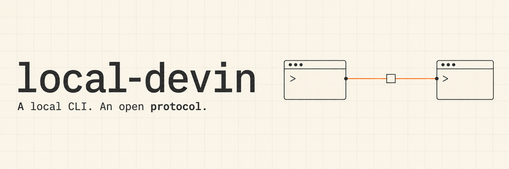

# local-devin

[English](README.md) · **简体中文** · [日本語](README.ja.md)

把本机 **Devin CLI** 封装为标准 MCP 服务。在 Claude Code、Cursor、Windsurf、Codex 等客户端中直接将开发子任务委派给本地 Devin，复用本机登录态与工具链，并按会话 ID 多轮追问。

```text
MCP 客户端  ── stdio ──▶  local-devin  ──▶  本机 Devin CLI  ──▶  本地代码库
```

- **零依赖即用**：仓库内置预构建产物 `dist/`，克隆后直接用 `node` 启动，无需 `npm install`，也无需额外申请 API Key。
- **定位清晰**：[官方 Devin MCP](https://docs.devin.ai/work-with-devin/devin-mcp) 用于管理云端实例，[Devin ACP](https://docs.devin.ai/cli/reference/commands#devin-acp) 供支持 ACP 的编辑器直连；本项目（非官方）专用于让任意 MCP 客户端调度本机 CLI 与本地会话。

## 快速开始

需安装 **Node.js 22+** 并完成 **Devin CLI** 登录（`devin auth status`）。首次在目标项目中使用前，先在该目录交互式运行一次 `devin` 以确认工作区信任。

1. 克隆仓库：

```sh
git clone https://github.com/aynls/Devin-mcp.git
```

2. 在客户端 MCP 配置中添加服务（替换为本机绝对路径）：

```json
{
  "mcpServers": {
    "local-devin": {
      "command": "node",
      "args": ["/ABSOLUTE/PATH/Devin-mcp/dist/index.js"],
      "env": {
        "DEVIN_CWD": "/ABSOLUTE/PATH/your-project"
      }
    }
  }
}
```

- **多项目切换**：可省略 `DEVIN_CWD`，改由调用工具时按需传入目标项目的绝对路径 `cwd`。
- **客户端找不到命令**：若桌面客户端不继承终端 `PATH`，将 `command` 改为 `node` 绝对路径，并在 `env` 中设置 `DEVIN_BIN` 指向 `devin` 可执行文件（Windows 下指向 `devin.exe`）。

## 工具

| 工具 | 参数 | 用途 |
| --- | --- | --- |
| `run_prompt` | `prompt`, `cwd?` | 启动新的非交互式任务，返回执行输出与 `sessionId`。 |
| `resume_session` | `prompt`, `sessionId`, `cwd?` | 按精确的 `sessionId` 继续指定会话，保留上下文。 |
| `list_sessions` | `cwd?` | 列出目标工作区的本地会话（`id`、`title`、`lastActivityAt`）。 |
| `auth_status` | 无 | 调用 `devin auth status` 检查本机登录状态。 |

`run_prompt` 与 `resume_session` 可选参数：`permissionMode`（`auto` | `accept-edits` | `smart` | `dangerous`，默认 `auto`）、`model`（模型名或别名）、`respectWorkspaceTrust`（默认 `true`）、`timeoutMs`（单次超时毫秒数）。

日常使用时直接用自然语言交由宿主 Agent 调度即可，例如：

> 用 local-devin 检查这个项目的测试结构，先别改代码；记下返回的 sessionId 方便接着追问。

## 配置

| 环境变量 | 默认值 | 说明 |
| --- | --- | --- |
| `DEVIN_CWD` | 未设置 | 默认工作区绝对路径；未设置时每次调用均需传入 `cwd`。 |
| `DEVIN_BIN` | 自动检测 | `devin` 可执行文件绝对路径。 |
| `DEVIN_MCP_TIMEOUT_MS` | `600000` | 单次命令超时上限（默认 10 分钟）。 |
| `DEVIN_MCP_MAX_OUTPUT_BYTES` | `1048576` | 单次输出上限（默认 1 MiB）。 |
| `DEVIN_MCP_ALLOW_DANGEROUS` | `false` | 设为 `true` 时允许请求 `permissionMode: "dangerous"`。 |
| `DEVIN_MCP_ALLOW_UNTRUSTED` | `false` | 设为 `true` 时允许请求 `respectWorkspaceTrust: false`。 |

任务采用同步调用，CLI 执行完毕后一次性返回结果；默认配置下建议将客户端的 MCP 工具超时设为 **11 分钟以上**。同一工作区同一时刻只运行一个任务。

## 开发

修改 `server/` 源码后需重新构建并提交 `dist/`：

```sh
npm ci
npm run check
npm run verify:package
```

## 许可证

[MIT](LICENSE)
